# Pacecourt CRM — Design Language Transformation Plan

## 1. Executive Summary & Source of Truth

This plan extracts the **Organisational Dashboard Design Language** (from the provided HTML spec and dashboard screenshots) and applies it systematically across the entire CRM.

### Core Directive
> **Maintain Layout & Core Structure 100%**: Do not alter routing, grid/flex hierarchies, component logic, props/emits, database schemas, or APIs. Focus purely on **visual look & feel**: typography, color tokens, surface treatments, radius ladder, navy-tinted elevation, pill buttons, and status chips.

---

## 2. Visual Reference Analysis

### Provided Screenshots & Design Language Reference

````carousel
```markdown
### Design Language Reference (from HTML Spec)
- **Primary Brand**: Deep Navy (`#0F2A45`) + Signature Acid-Lime (`#9AC72C`)
- **Background**: Soft cream/sage gradient (`radial-gradient(circle at top left, #fbfdf6 0%, #f3f7ea 26%, #eef3e7 48%, #eef2ec 100%)`)
- **Cards**: Clean white `#FFFFFF` with `rounded-2xl` to `rounded-3xl` and navy shadows (`rgba(15,42,69,...)`)
- **Buttons**:
  - Primary: Signature black-to-lime gradient pill (`linear-gradient(90deg, #0f0f0f 0%, #9ac72c 100%)`) with white bold text
  - Secondary: White pill with subtle navy-tinted border (`1px solid rgba(15,42,69,0.15)`)
- **Typography**: Geist Sans for UI/body, Geist Mono for numbers/dates/currency, Poppins for brand display
- **Status Chips**: Specific pastel background and rich foreground pairs for Lead/Deal pipelines
```
<!-- slide -->
```markdown
### Screenshot 1: Leads Dashboard
- **Sidebar**: Floating rounded white card (`rounded-[24px]`) on cream background with PACECOURT logo and lime pill active item (`#EEF6DA` bg + `#5F7F17` text)
- **Header**: Bold Navy title (`Leads •`) with green accent dot, date range pill, and black-to-lime "+ Add lead" CTA
- **KPI Row**: White cards with 3px top gradient accents, colored squircle icons, Geist Mono figures, and delta chips
- **Content Area**: White rounded container cards (`rounded-3xl`) with soft `#E6E9E2` borders
```
<!-- slide -->
```markdown
### Screenshot 2: Sales Cycle & Pipeline
- **Tabs / Sub-nav**: Pill-shaped segmented tabs (`Pipeline`, `Projects`, etc.) in a subtle track
- **Hero Card**: Dark navy container (`#0F2A45`) for pipeline totals with huge Geist Mono currency values (`₹31.99L`)
- **Multi-phase Pipeline Stages**: Color-coded stage headers from Navy to Teal, Forest Green, and vibrant Lime
- **Data Tables**: Geist Mono numbers aligned in columns with rounded status chips
```
````

---

## 3. Strict Boundary: What Changes vs. What Stays Untouched

| Layer | Stays Untouched (Preserved) | Will Be Transformed (Visual Refresh) |
|---|---|---|
| **App Shell & Layout** | Flexbox layout, split panes, routes, mobile collapse logic, drawer behavior | Canvas background (warm cream radial gradient), sidebar styling (floating rounded card), margins & padding rhythm |
| **Component Logic** | Vue composables (`useDocument`, `viewsStore`, `quotations.js`), API calls, resources | CSS classes, colors, border-radii, typography styles, shadows |
| **Navigation & Sidebar** | Router routes, permission checks, view switching, dropdown menus | Active link styling (lime pill with dark lime text), Pacecourt brandmark, floating user footer card |
| **Buttons & Controls** | Click handlers, loading spinners, icons, disabled states | Shape (pill `rounded-full`), primary button gradient (black → lime), hover scale `1.02`, focus rings |
| **Data Tables & Lists** | Sorting, pagination, filtering logic, columns configuration | Card container styling (`rounded-3xl`), Geist Mono fonts for numbers/currency/dates, status chip colors |
| **Forms & Fields** | Form validation, DocType metadata, fields layout, link selectors | Input surface (`#FAFBF7`), `10px` input radius, lime focus halo, clean typography |
| **Modals & Dialogs** | Modal state management, submit actions, step wizards | Dialog container radius (`rounded-3xl`), navy-tinted elevation shadow, pill action buttons |

---

## 4. Complete Design Token System

### 4.1 Color Tokens
```css
:root {
  /* Brand Core */
  --pc-navy: #0F2A45;
  --pc-navy-deep: #0B1F33;
  --pc-lime: #9AC72C;
  --pc-lime-dark: #5F7F17;
  --pc-lime-tint: #EEF6DA;
  --pc-lime-tint-subtle: #F2F8E2;

  /* Surfaces & Canvas */
  --pc-bg: #EEF2EC;
  --pc-bg-grad: radial-gradient(circle at top left, #FBFDF6 0%, #F3F7EA 26%, #EEF3E7 48%, #EEF2EC 100%);
  --pc-surface: #FFFFFF;
  --pc-surface-2: #FAFBF7;
  --pc-surface-subtle: #EEF0EA;

  /* Borders & Outlines */
  --pc-border: #E6E9E2;
  --pc-border-soft: #EEF0EA;
  --pc-border-focus: rgba(154, 199, 44, 0.5);

  /* Typography / Inks */
  --pc-ink: #0B1F33;
  --pc-ink-heading: #0F2A45;
  --pc-muted: #5F6B7A;
  --pc-muted-2: #8A94A3;

  /* Navy Shadow Base */
  --pc-shadow-rgb: 15, 42, 69;
}
```

### 4.2 Status Chips & Badges Mapping
| Status Category | Background | Foreground Text | Where Used |
|---|---|---|---|
| **Good / Converted / Won** | `#EEF6DA` / `#E7F6EC` | `#5F7F17` / `#17663A` | Deal Won, Converted, Active Dealer, Accepted Quotation |
| **Bad / Disqualified / Lost** | `#FDECEA` / `#FBECEB` | `#A4231A` / `#A4342A` | Deal Lost, Disqualified, Inactive Dealer, Expired |
| **Neutral / Contacted / Attempting**| `#E6F1FA` | `#1D6F86` | New Lead, Attempting Contact, Draft Quotation |
| **Warning / MQL / Pending** | `#FDF3E0` / `#FFF4D6` | `#8A6410` / `#7A5300` | MQL, Under Review, Pending Feedback |
| **SQL / Opportunity / Negotiation** | `#F0E9FB` | `#6A4BA8` | SQL, In Negotiation, Authorized Applicator |

### 4.3 Typography Scale
- **Fonts**:
  - `font-sans`: `'Geist', -apple-system, BlinkMacSystemFont, 'Segoe UI', Roboto, sans-serif`
  - `font-mono`: `'Geist Mono', ui-monospace, 'SF Mono', monospace` (for all numbers, currencies, dates, IDs)
  - `font-display`: `'Poppins', sans-serif` (reserved for branding / login display)
- **Hierarchy**:
  - Page Titles: `28px - 30px`, Extrabold `800`, tracking `-0.02em`, color `#0F2A45`
  - Section Headings: `18px - 20px`, Bold `800`, color `#0F2A45`
  - Card Titles: `15px - 16px`, Bold `700`, color `#0F2A45`
  - Body Text: `13.5px - 14px`, Regular `400` / Medium `500`, color `#0B1F33`
  - Captions / Meta: `12px - 13px`, Medium `500`, color `#5F6B7A`
  - Eyebrows: `11px`, Semibold `600`, tracking `0.08em`, uppercase, color `#5F6B7A`
  - Data / Metrics: `font-mono`, Bold `800`

### 4.4 Elevation & Radii Ladder
- **Radius Scale**:
  - `10px - 12px`: Form inputs, search fields, quick filter inputs
  - `16px`: Metric tiles, small cards, tooltips
  - `24px`: Main panels, table cards, detail view cards
  - `28px - 32px`: Floating sidebar, modal shells, app container
  - `9999px` (`rounded-full`): All interactive components — buttons, pills, chips, active tabs, breadcrumb pills, avatars
- **Navy Shadow Scale**:
  - Card: `0 8px 18px rgba(15, 42, 69, 0.06)`
  - Panel: `0 12px 30px rgba(15, 42, 69, 0.05)`
  - Shell / Modal: `0 24px 50px rgba(15, 42, 69, 0.12)`

---

## 5. Detailed Component Transformation Strategy

```mermaid
flowchart TD
    A[Design Language CSS Engine] --> B[Global Styles & Index.html]
    A --> C[Desktop Layout & Floating Sidebar]
    A --> D[Header & ViewControls Filter Bar]
    A --> E[Button & Interactive Component Theming]
    A --> F[List Views, Data Tables & Cards]
    A --> G[Modals, Form Fields & Dialogs]
    
    B --> B1[Google Fonts: Geist, Geist Mono, Poppins]
    B --> B2[Frappe-UI CSS Variable Re-mapping]
    B --> B3[Top 3px Black-to-Lime Navigation Bar]

    C --> C1[Floating Sidebar Card rounded-3xl with Navy Shadow]
    C --> C2[Active Navigation Item: Lime Pill #EEF6DA + #5F7F17]
    C --> C3[Pacecourt Logo with Lime Accent Line]

    D --> D1[Page Title in Navy #0F2A45 + Green Dot Indicator]
    D --> D2[Pill Filter Chips & Rounded Search Inputs]

    E --> E1[Primary Button: Black-to-Lime Gradient Pill]
    E --> E2[Secondary Button: White Pill + Navy Border]
    E --> E3[Lime Focus Halo for Inputs]

    F --> F1[Table Wrapper: White Card rounded-3xl]
    F --> F2[Numbers & Currency in Geist Mono font]
    F --> F3[Pill Status Chips with Exact Hex Palette]
```



### 5.1 Global Styles & CSS Variables (`frontend/src/index.css`)
- Re-map Frappe UI’s semantic tokens so built-in components automatically look native to the new design:
  - `--surface-base`: `var(--pc-surface)` (`#FFFFFF`)
  - `--surface-sidebar`: `var(--pc-surface)` (`#FFFFFF`)
  - `--surface-gray-1`: `var(--pc-bg)` (`#EEF2EC`)
  - `--surface-gray-2`: `var(--pc-surface-2)` (`#FAFBF7`)
  - `--surface-gray-3`: `var(--pc-surface-subtle)` (`#EEF0EA`)
  - `--ink-gray-9`: `var(--pc-navy)` (`#0F2A45`)
  - `--ink-gray-8`: `var(--pc-navy-deep)` (`#0B1F33`)
  - `--ink-gray-7`: `var(--pc-muted)` (`#5F6B7A`)
  - `--ink-gray-5`: `var(--pc-muted-2)` (`#8A94A3`)
  - `--outline-gray-1`: `var(--pc-border-soft)` (`#EEF0EA`)
  - `--outline-gray-2`: `var(--pc-border)` (`#E6E9E2`)
  - `--elevation-sm`: `0 8px 18px rgba(15, 42, 69, 0.06)`
  - `--elevation-md`: `0 12px 30px rgba(15, 42, 69, 0.05)`
  - `--elevation-lg`: `0 24px 50px rgba(15, 42, 69, 0.12)`
- Add the app background rule to `html`, `body`, and desktop canvas:
  ```css
  body, #app {
    background-color: var(--pc-bg);
    background-image: var(--pc-bg-grad);
    background-attachment: fixed;
    font-family: 'Geist', ui-sans-serif, system-ui, -apple-system, sans-serif;
    color: var(--pc-ink);
  }
  ```

### 5.2 Floating Sidebar Transformation (`AppSidebar.vue`)
- **Card Enclosure**: Rather than a flat, full-height edge-to-edge column, wrap the desktop sidebar as a floating rounded panel:
  - `margin: 12px 0 12px 12px; border-radius: 24px; background: #FFFFFF; border: 1px solid #E6E9E2; box-shadow: 0 12px 30px rgba(15, 42, 69, 0.05); overflow: hidden;`
- **Branding Header**:
  - PACECOURT logo mark + tagline: *"Smarter marketing insights for faster, better decisions."*
  - 3px horizontal lime accent bar beneath the tagline.
- **Active Navigation Item**:
  - `border-radius: 9999px;` (Pill shape)
  - Active background: `#EEF6DA` (Lime tint)
  - Active text: `#5F7F17` (Lime dark, font-weight 700)
  - Active icon: `#5F7F17`
  - Inactive hover: `#FAFBF7` with smooth 150ms transition.
- **Bottom User Profile**:
  - Clean pill container with circular avatar, user name, and role.

### 5.3 Desktop Canvas & App Header (`DesktopLayout.vue`, `AppHeader.vue`, `LayoutHeader.vue`)
- **Main Canvas**:
  - `margin: 12px; border-radius: 24px; background: transparent; overflow: hidden;`
- **Header**:
  - Clean white header card or seamless integration with page header.
  - Page titles: Bold Navy `#0F2A45` (`font-extrabold text-2xl text-[var(--pc-navy)]`) with green accent dot (`•`).
  - Breadcrumbs & View Selector: Styled as white pills with navy border.

### 5.4 View Controls & Filter Bar (`ViewControls.vue`)
- **Search & Filters**:
  - Quick filter inputs: Pill shape or 10px rounded inputs with `#FAFBF7` fill, soft border, and lime focus ring.
  - Action buttons (Filter, Sort, Columns, Refresh): White pill buttons with `border: 1px solid rgba(15, 42, 69, 0.15)`, navy shadow `0 8px 18px rgba(15, 42, 69, 0.06)`, and bold text.

### 5.5 Universal Button Theming
- **Primary Action (Create / Save / Add / Submit)**:
  - `background: linear-gradient(90deg, #0F0F0F 0%, #9AC72C 100%) !important;`
  - `color: #FFFFFF !important;`
  - `border-radius: 9999px !important;`
  - `font-weight: 700 !important;`
  - `box-shadow: 0 8px 18px rgba(94, 128, 25, 0.24) !important;`
  - Hover: `transform: scale(1.02); transition: transform 0.15s ease;`
- **Secondary Action (Cancel / Export / Filter / Back)**:
  - `background: #FFFFFF !important;`
  - `color: #0F2A45 !important;`
  - `border: 1px solid rgba(15, 42, 69, 0.15) !important;`
  - `border-radius: 9999px !important;`
  - `font-weight: 700 !important;`
  - `box-shadow: 0 8px 18px rgba(15, 42, 69, 0.06) !important;`
  - Hover: `background: #FAFBF7 !important;`

### 5.6 List Views & Data Tables (`DealersListView.vue`, `QuotationsListView.vue`, etc.)
- Enclose the list table within a rounded white card:
  - `background: #FFFFFF; border-radius: 24px; border: 1px solid #E6E9E2; box-shadow: 0 12px 30px rgba(15, 42, 69, 0.05);`
- Format all numeric, currency (₹), date, and ID fields using `font-mono` (`'Geist Mono'`).
- Ensure row hover uses soft `#FAFBF7`.
- Style badges using the exact status chip hex table.

### 5.7 Detail Pages & Record Views (`Lead.vue`, `Deal.vue`, `Quotation.vue`)
- Left main panels & Right sidebar panels: Rendered as clean rounded white cards (`rounded-2xl`, `#E6E9E2` border, navy shadow).
- Section breaks and tabs: Pill segmented controls (`rounded-full` in `#FAFBF7` track).
- Scope of work, line items table, and totals section: Crisp white backgrounds, navy headers, Geist Mono totals.

### 5.8 Modals & Dialogs
- Modal shells: `rounded-3xl` (`24px - 28px`), navy-tinted elevation shadow (`0 24px 50px rgba(15, 42, 69, 0.12)`).
- Modal headers: Bold Navy text `#0F2A45`.
- Modal inputs: `#FAFBF7` fill, 10px radius, lime focus border.
- Modal footers: White secondary pill on left ("Cancel"), Black-to-lime primary pill on right ("Create Dealer" / "Save").

### 5.9 Ambient Top Loading Bar
- Global 3px top loader attached to router transitions in `App.vue`:
  - `height: 3px; background: linear-gradient(90deg, #0F0F0F 0%, #9AC72C 100%);`

---

## 6. Phased Execution Roadmap

### Phase 1: Foundations & Token Infrastructure
1. Update [`frontend/index.html`](file:///root/pacecourt/frontend/index.html) to preconnect and load `Geist`, `Geist Mono`, and `Poppins` from Google Fonts.
2. Update [`frontend/src/index.css`](file:///root/pacecourt/frontend/src/index.css):
   - Inject the design tokens (`--pc-*`).
   - Map Frappe UI variables (`--surface-*`, `--ink-*`, `--outline-*`, `--elevation-*`).
   - Add global body radial gradient.
   - Define global utility classes (`.btn-primary-pill`, `.btn-secondary-pill`, `.font-mono-numbers`, `.card-surface`, `.status-chip-*`).

### Phase 2: App Shell & Sidebar Transformation
1. Update [`DesktopLayout.vue`](file:///root/pacecourt/frontend/src/components/Layouts/DesktopLayout.vue) to establish the floating layout rhythm.
2. Update [`AppSidebar.vue`](file:///root/pacecourt/frontend/src/components/Layouts/AppSidebar.vue):
   - Apply floating card container with `rounded-3xl`, `#FFFFFF`, and navy shadow.
   - Insert PACECOURT branding with subtitle and 3px lime indicator.
   - Apply lime pill active state (`#EEF6DA` bg + `#5F7F17` text) to active sidebar items.
   - Refactor user footer into a clean floating pill.

### Phase 3: Header, Breadcrumbs & View Controls
1. Update [`LayoutHeader.vue`](file:///root/pacecourt/frontend/src/components/LayoutHeader.vue) and [`ViewBreadcrumbs.vue`](file:///root/pacecourt/frontend/src/components/ViewBreadcrumbs.vue) to render bold navy titles with green accent dot.
2. Update [`ViewControls.vue`](file:///root/pacecourt/frontend/src/components/ViewControls.vue) to convert action buttons, filters, and dropdowns into styled pills.

### Phase 4: Data Tables, List Views & Badges
1. Style [`DealersListView.vue`](file:///root/pacecourt/frontend/src/components/ListViews/DealersListView.vue) and [`QuotationsListView.vue`](file:///root/pacecourt/frontend/src/components/ListViews/QuotationsListView.vue):
   - Wrap in rounded white cards with `#E6E9E2` border.
   - Apply `Geist Mono` typography to numbers, currency, and dates.
   - Update status badge classes to match the status chip hex palette.
2. Update [`EmptyState.vue`](file:///root/pacecourt/frontend/src/components/ListViews/EmptyState.vue) with clean pill CTAs.

### Phase 5: Modals, Dialogs & Top Loading Bar
1. Update [`DealerModal.vue`](file:///root/pacecourt/frontend/src/components/Modals/DealerModal.vue) and [`QuotationModal.vue`](file:///root/pacecourt/frontend/src/components/Modals/QuotationModal.vue) with pill action buttons and rounded-3xl dialog shells.
2. Add the 3px ambient black-to-lime top loading bar to [`App.vue`](file:///root/pacecourt/frontend/src/App.vue).

### Phase 6: Verification & Polish
1. Run all 30 test files (`yarn test:run`) in `frontend/` to confirm zero regression.
2. Rebuild frontend via `yarn build` in container to ensure clean compilation.
3. Verify visual coherence across Leads, Deals, Quotations, and Dealers.

---

## 7. Review & Next Steps

This plan achieves the visual aesthetic of the Pacecourt Organisational Dashboard without altering any core logic, table relationships, or backend APIs. 

**Awaiting your review and feedback before proceeding to execution.**
