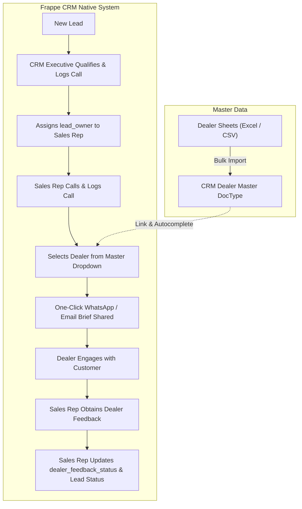
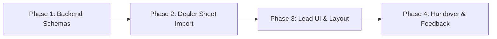

# Dealer Assignment Architecture & Implementation Plan

> **Scope**: Implement Dealer Management and Assignment for Pacecourt CRM  
> **Status**: Ready for Execution  
> **Constraint**: Zero external ERP dependencies or mentions; standalone Frappe CRM architecture  

---

## 1. Executive Summary & Problem Context

In Pacecourt's business model, customer leads progress through a multi-stage sales handoff pipeline:

1. **Inquiry & Initial Qualification**: An inquiry enters the CRM. A **CRM Executive** makes the initial call, captures sport requirements (court type, area, layer system, location), logs the call, and updates the record.
2. **Internal Assignment**: The CRM Executive assigns the lead to a regional **Sales Representative**.
3. **Technical Discovery**: The Sales Representative calls the prospect, assesses site readiness, specifications, and commercial intent, and logs the call.
4. **Dealer Handover (The Current Gap)**: The Sales Representative selects a suitable **Dealer / Applicator** from the company's external spreadsheets ("dealer sheets") and assigns the lead to that dealer. 
5. **Dealer Feedback & Pipeline Update**: The internal CRM intake pauses while the dealer engages with the client. The Sales Representative later follows up with the dealer and updates the CRM status based on feedback (*Converted, Quotation Sent, Material Ordered, Lost*).

### The Current Gap
* Dealers currently live in external Google Sheets / Excel files.
* There is no native `CRM Dealer` master record inside the CRM.
* Sales Reps cannot assign leads to dealers directly in the CRM UI.
* There is no audit history of which dealer received which lead, when it was handed over, or what the dealer reported back.

---

## 2. Core Architecture & Design



---

## 3. Data Model Specifications

### 3.1 DocType: `CRM Dealer` (Standalone Master)
* **DocType Name**: `CRM Dealer`
* **Module**: `FCRM`
* **Naming**: `field:dealer_name` (or format `DLR-.YYYY.-#####`)
* **Fields**:
  | Fieldname | Label | Fieldtype | Options / Description |
  |---|---|---|---|
  | `dealer_name` | Dealer / Company Name | Data | Unique, required (e.g. *Apex Sports Infra*) |
  | `contact_person` | Contact Person | Data | Primary contact person (e.g. *Rajesh Sharma*) |
  | `mobile_no` | Mobile No. | Data | Phone format (used for WhatsApp & calling) |
  | `email` | Email | Data | Email address for email summaries |
  | `territory` | Territory | Link -> `CRM Territory` | North, West, South, East, etc. |
  | `city` | City | Data | City location (e.g. Noida, Pune, Bangalore) |
  | `state` | State | Data | State location |
  | `tier` | Dealer Tier | Select | *Authorized Applicator*, *Direct Dealer*, *Distributor* |
  | `status` | Status | Select | *Active*, *Inactive* (Default: *Active*) |
  | `sports_specialization` | Specialization | Small Text | e.g. *Tennis, Badminton, Pickleball, Synthetic Turf* |
  | `address` | Full Address | Small Text | Physical office / warehouse address |
  | `notes` | Internal Notes | Small Text | Key account notes or background |

---

### 3.2 Additions to `CRM Lead` (and `CRM Deal`)
Add these minimal, non-breaking fields to `crm_lead.json` and `crm_deal.json`:

| Fieldname | Label | Fieldtype | Options / Behavior |
|---|---|---|---|
| `dealer` | Assigned Dealer | Link | Options: `CRM Dealer`. Autocomplete searchable. |
| `dealer_assigned_date` | Dealer Assigned Date | Datetime | Automatically populated when `dealer` is set. |
| `dealer_assigned_by` | Assigned By | Link -> `User` | Automatically recorded as current user. |
| `dealer_feedback_status` | Dealer Feedback Status | Select | Options:<br>• `Pending Contact`<br>• `Site Visit Scheduled`<br>• `Site Visit Completed`<br>• `Quotation Sent by Dealer`<br>• `Material Ordered`<br>• `Dropped / Lost` |
| `dealer_notes` | Dealer Notes | Small Text | Specific feedback or site remarks from the dealer. |

---

### 3.3 Dynamic Side Panel Placement via `CRM Fields Layout`
Frappe CRM dynamically constructs the Lead and Deal view panels using the JSON stored in `CRM Fields Layout`.
* Under `CRM Lead-Side Panel` and `CRM Deal-Side Panel`, inject a clean collapsible section:
```json
{
  "name": "dealer_handover_section",
  "label": "Dealer Handover",
  "opened": true,
  "columns": [
    {
      "name": "dealer_column",
      "fields": [
        "dealer",
        "dealer_assigned_date",
        "dealer_feedback_status",
        "dealer_notes"
      ]
    }
  ]
}
```
* **Advantage**: Requires zero template surgery; the standard Frappe CRM input controls, autocompletes, and inline edits render automatically.

---

## 4. One-Click Handover: "Share with Dealer"

To make the handover frictionless for Sales Representatives:

1. **Pre-Formatted WhatsApp Brief**:
   A quick button or dropdown action on the Lead view creates a direct WhatsApp link:
   ```
   https://wa.me/{dealer_mobile}?text=Hi {dealer_contact}, new lead assigned:%0A%0A
   *Client*: {lead_name}%0A
   *Mobile*: {mobile_no}%0A
   *City*: {city}%0A
   *Court Requirement*: {court_type} - {court_count} courts%0A
   *Notes*: {dealer_notes}%0A%0A
   Please connect and share update.
   ```
2. **Auto-Activity Log**:
   Clicking the share link automatically logs an activity timeline entry:
   `"Lead brief shared with Dealer [Dealer Name] via WhatsApp"`.

---

## 5. Execution Roadmap



### Phase 1: Backend DocType & Fields
* Create `crm/fcrm/doctype/crm_dealer/` (`crm_dealer.json`, `crm_dealer.py`).
* Add `dealer`, `dealer_assigned_date`, `dealer_assigned_by`, `dealer_feedback_status`, and `dealer_notes` to `crm_lead.json` and `crm_deal.json`.
* Run database migration to create MariaDB tables and columns cleanly.

### Phase 2: Sheet Migration (Dealers Import)
* Format the existing "dealer sheets" into a clean CSV template matching the `CRM Dealer` schema.
* Import the dealers into the CRM database so all dealers are immediately selectable in dropdowns.

### Phase 3: UI Layout & Autocomplete
* Update `CRM Lead-Side Panel` in `CRM Fields Layout` so the "Dealer Handover" section displays in the right sidebar.
* Support instant search by dealer name, city, or territory.

### Phase 4: Lead Status Pipeline & Reporting
* Optional: Add `Assigned to Dealer` to `CRM Lead Status`.
* Create filtered list views:
  * *"Leads with Dealers - Awaiting Feedback"*
  * *"Leads by Dealer"* (to track dealer performance and material conversion).
* Verify with automated unit tests and rebuild frontend bundle.

---

## 6. Verification Checklist
- [ ] `CRM Dealer` DocType created and accessible in Desk / API.
- [ ] Data import of existing dealer sheets completed without duplicates.
- [ ] Lead side panel displays Dealer selector, assigned date, and feedback fields.
- [ ] Selection of dealer persists properly on Lead save.
- [ ] Lead conversion to Deal carries forward the linked dealer.
- [ ] Zero mention or dependency on external ERP modules across all files.
- [ ] All frontend unit tests pass cleanly.
