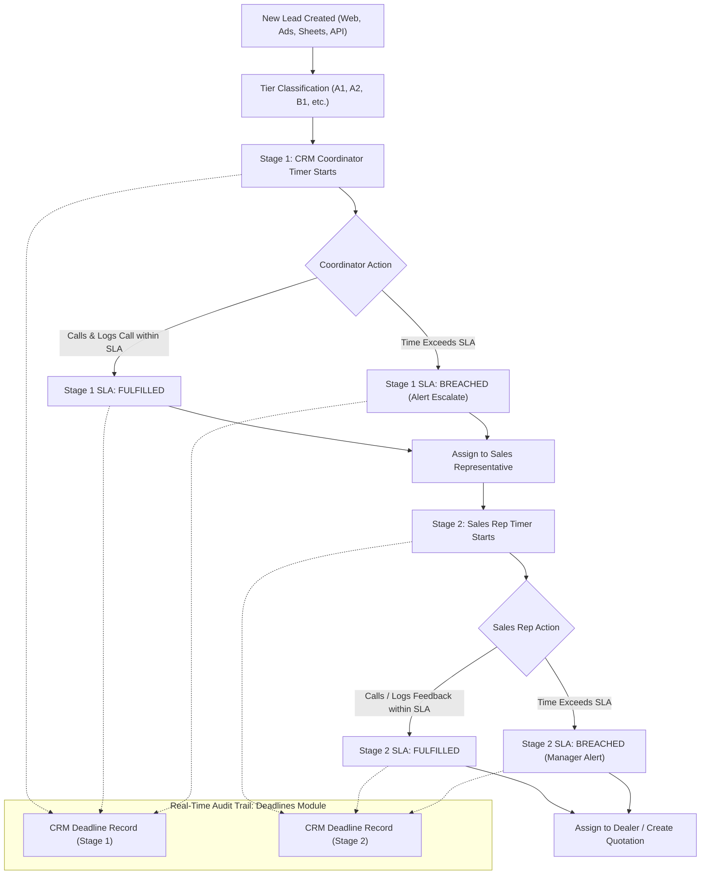
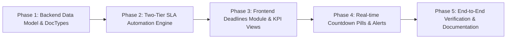

# Master Plan: Two-Tier Lead SLA Timers & Deadlines Module

## Executive Summary

Currently, the CRM triggers an SLA timer (e.g., 4 hours for Tier A1) only **after** a lead is assigned to a Sales Representative (`lead_owner`). However, in the company's real-world sales process, an initial **CRM Coordinator / Controller** receives the incoming lead first, conducts the initial triage call, verifies customer and court details, and then assigns the lead to a Sales Representative.

Because there is currently no timer or accountability tracking for the CRM Coordinator stage, leads can sit uncalled in the triage queue indefinitely without any breach or notification. 

This master plan outlines the end-to-end architecture to:
1. **Automate Stage 1 (Coordinator Triage SLA)**: Immediately start a timer when a lead arrives in CRM according to its tier classification.
2. **Automate Stage 2 (Sales Rep Follow-up SLA)**: Transition the timer to the Sales Representative once assigned, with its own independent SLA.
3. **Build the "Deadlines" Module**: A dedicated, real-time monitoring and historical audit DocType and UI dashboard tracking every deadline, allotted time, actual time taken, breach status, and fulfilling call logs.

---

## 1. Two-Tier SLA Architecture

---

## 2. Proposed Tier SLA Matrices

We suggest configuring separate SLA durations for **CRM Coordinators** (rapid initial qualification) and **Sales Representatives** (in-depth consultation and proposal preparation):

| Tier | Priority / Description | Coordinator SLA (Stage 1) | Sales Rep SLA (Stage 2) | Combined Target |
| :--- | :--- | :--- | :--- | :--- |
| **A1** | High Fit (≥35), High Intent (≥35) | **30 Minutes - 1 Hour** | **4 Hours** | **< 5 Hours** |
| **A2** | High Fit (≥35), Med Intent (20-34) | **2 Hours** | **24 Hours** | **< 26 Hours** |
| **B1** | Med Fit (25-34), High Intent (≥35) | **2 Hours** | **24 Hours** | **< 26 Hours** |
| **B2** | Med Fit (25-34), Med Intent (20-34) | **4 Hours** | **48 Hours** | **< 52 Hours** |
| **C1 / C2** | Low Fit (<25) / Standard Inquiries | **8 Hours / 1 Day** | **48 Hours** | **< 72 Hours** |

> [!TIP]
> **Working Hours vs 24/7 Clock**: We recommend respecting company business hours (e.g., 9:30 AM to 6:30 PM, Monday to Saturday). Leads arriving at 11:00 PM will have their Coordinator SLA count starting from 9:30 AM the next business morning, preventing artificial midnight breaches.

---

## 3. Data Model: `CRM Deadline` DocType

We will create a first-class Frappe DocType named `CRM Deadline` to maintain a dedicated audit log and monitoring engine.

### DocType Fields:
| Field Name | Type | Options / Reference | Description |
| :--- | :--- | :--- | :--- |
| `name` | Data | Auto-named (e.g. `DLN-.YYYY.-.#####`) | Unique Deadline ID |
| `lead` | Link | `CRM Lead` | Associated Lead |
| `lead_name` | Data | Fetched from Lead | Full Lead / Customer Name |
| `stage` | Select | `Coordinator Triage` `Sales Rep Follow-up` | Active SLA stage |
| `assigned_to` | Link | `User` | Responsible person (Coordinator or Rep) |
| `tier` | Data | A1, A2, B1, etc. | Lead Tier at timer start |
| `allotted_hours` | Float | - | Hours given for this stage |
| `started_at` | Datetime | - | When this stage timer began |
| `deadline_at` | Datetime | - | Exact target deadline |
| `completed_at` | Datetime | - | When first call was logged or stage completed |
| `time_taken_mins`| Int | - | Actual duration in minutes (`completed_at - started_at`) |
| `status` | Select | `Active` `Fulfilled` `Breached` `Cancelled` | Current SLA status |
| `breach_mins` | Int | - | Minutes late if breached |
| `call_log` | Link | `CRM Call Log` | Specific call that fulfilled the deadline |
| `reminder_sent` | Check | 0/1 | 1-hour before deadline alert |
| `warning_sent` | Check | 0/1 | Breach escalation alert |
| `notes` | Small Text | - | System / escalation remarks |

---

## 4. Backend Automation Engine

### 1. `on_lead_insert` / `on_lead_update`:
- **When Lead is Created**:
  - Compute lead tier (from fit & intent scores).
  - Look up Coordinator SLA hours from tier matrix.
  - Automatically insert a `CRM Deadline` record: `stage = "Coordinator Triage"`, `status = "Active"`, `assigned_to = default_coordinator` (or Coordinator Queue).
  - Update `CRM Lead` fields: `custom_coordinator_deadline`, `custom_coordinator_sla_status = "Active"`.
- **When Coordinator Logs Call or Assigns Lead**:
  - The Stage 1 `CRM Deadline` is closed: `completed_at = now()`. If `now() <= deadline_at`, marked `Fulfilled`; if late, marked `Breached`.
  - Once `lead_owner` is assigned to a Sales Rep:
    - Automatically create Stage 2 `CRM Deadline`: `stage = "Sales Rep Follow-up"`, `status = "Active"`, `assigned_to = doc.lead_owner`.
    - Update `CRM Lead` fields: `response_by = deadline`, `sla_status = "First Response Due"`.

### 2. `on_call_log_insert`:
- When a Call Log is recorded for a `CRM Lead`:
  - Identify who made the call (`call._caller`).
  - If an active `Coordinator Triage` deadline exists, fulfill it.
  - If an active `Sales Rep Follow-up` deadline exists, fulfill it with actual completion time.

### 3. Background Cron Job (Every 5 Minutes):
- Query all `CRM Deadline` where `status = "Active"`.
- **1 Hour Before Deadline**: Send reminder notification to `assigned_to` ("⏰ 45 minutes left to contact Lead X").
- **Past Deadline (`now > deadline_at`)**:
  - Update `status = "Breached"`.
  - Calculate `breach_mins = time_diff_in_seconds(now, deadline_at) // 60`.
  - Send alert to `assigned_to` + escalate to CRM Admin / Sales Manager.

---

## 5. Frontend "Deadlines" Module Design

### 1. Sidebar Navigation
- Add **Deadlines** entry to `AppSidebar.vue` with a dedicated timer icon (`lucide-clock` / `lucide-timer`).
- Positioned under Sales Cycle / Leads for quick operational access.

### 2. Deadlines Dashboard & List View (`/crm/deadlines`)
- **KPI Summary Cards** on top:
  1. **Active Deadlines** (Timers currently counting down)
  2. **Breached Today** (Overdue leads requiring immediate managerial attention)
  3. **Coordinator Avg Response** (e.g. `24m` vs `1h` target)
  4. **Sales Rep Avg Response** (e.g. `2.8h` vs `4h` target)
  5. **Compliance Rate** (e.g. `94.2%` on-time rate)
- **Quick Filter Tabs**:
  - **All**
  - **Active** (Running timers)
  - **Breached** (Overdue)
  - **Coordinator Stage** (Triage queue)
  - **Sales Rep Stage** (Field rep queue)
  - **Fulfilled** (Historical on-time logs)
- **Table Columns**:
  - **Lead Name & Tier** (with Pacecourt tier badge: `A1`, `B1`, etc.)
  - **Stage** (`Coordinator Triage` vs `Sales Rep Follow-up`)
  - **Responsible Person** (Avatar + Name)
  - **Allotted Time** (e.g. `1h`, `4h`)
  - **Deadline** (Exact date/time)
  - **Remaining / Overdue** (Live pill: `Green - 28m left` or `Red - 45m overdue`)
  - **Status** (Pacecourt status pill: `Active`, `Fulfilled`, `Breached`)
  - **Time Taken** (e.g. `18m`, `3.2h`, `-`)

### 3. Lead Detail View & Leads List Enhancements
- In the Leads List view, add a **Deadline** column showing the current active timer or badge.
- In the Lead Detail header, display a prominent live timer pill:
  - `🟢 Coordinator Call: 35m left`
  - `🟡 Rep Follow-up: 52m left`
  - `🔴 SLA Breached by 1h 12m`

---

## 6. Implementation Phasing

1. **Phase 1: Backend Data Model**
   - Create `CRM Deadline` DocType with full tracking fields and permissions.
   - Add stage tracking fields to `CRM Lead` (`custom_coordinator_deadline`, `custom_coordinator_sla_status`).
2. **Phase 2: Automation Engine & Hooks**
   - Refactor `crm/automation/lead_sla.py` into a unified `deadlines.py` supporting both Coordinator and Rep stages.
   - Wire `CRM Lead` insert/update and `CRM Call Log` insert hooks.
   - Schedule 5-minute cron for reminders and breach escalations.
3. **Phase 3: Frontend Deadlines Module**
   - Create `Deadlines.vue` and `DeadlinesListView.vue` with KPI tiles, filter pills, and Pacecourt design language.
   - Add `/deadlines` route and sidebar navigation link with clock icon.
4. **Phase 4: Countdown Pills & Notifications**
   - Integrate live timer pill in `Lead.vue` and `LeadsListView.vue`.
   - Real-time WebSocket notifications for 1-hour reminders and breach alerts.
5. **Phase 5: Verification & Testing**
   - Unit tests for deadline calculation, stage transitions, and breach detection.
   - Verification with sample leads across all tiers.

